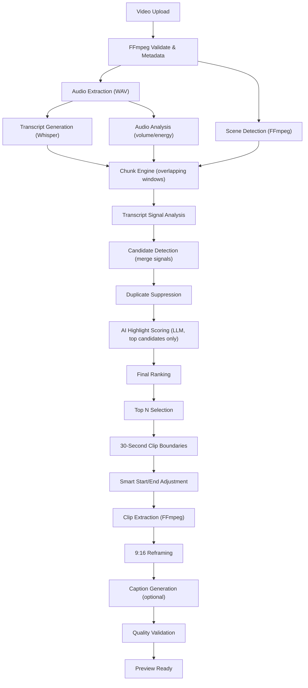

# AI Automatic Shorts Generator — Implementation Plan

Build a production-ready web application that analyzes 20–30 minute videos and automatically generates the best 30-second vertical Shorts using a staged AI pipeline: FFmpeg → audio/transcript → scene/chunk analysis → highlight scoring → top candidates → 30-second clips.

## Workspace & Relationship to Existing Code

- **Target directory**: `e:\video automation\clipping` (empty, fresh project)
- **Reference project**: The existing `batchgenerator` is a 2D Animation Auto-Sync Studio — a *different* app. We will **not modify it**, but will learn from its architecture (monorepo workspaces, Express + Vite + Zustand, FFmpeg pipeline, WebSocket progress).
- **Reusable patterns**: monorepo layout, FFmpeg spawning, WebSocket progress, storage service patterns, SRT generation, config structure.

---

## Tech Stack

| Layer | Technology | Rationale |
|---|---|---|
| **Monorepo** | npm workspaces | Matches existing pattern; simple |
| **Frontend** | React 18 + TypeScript + Vite | Same proven stack |
| **Styling** | Vanilla CSS (design tokens + modules) | Per user rules |
| **State** | Zustand | Lightweight, proven |
| **Backend** | Node.js + Express + TypeScript | Matches existing |
| **Database** | SQLite via `better-sqlite3` | Zero-config, relational, fast. Proper SQL tables — NOT the JSON-file DB |
| **Media Processing** | FFmpeg (spawn) + fluent-ffmpeg | Core requirement |
| **Transcription** | `openai` SDK (Whisper API) OR local `faster-whisper` via Python subprocess | Configurable |
| **AI Analysis** | OpenAI / Anthropic / Google AI API (configurable via env) | LLM for highlight scoring |
| **Real-time** | WebSocket (ws) | Processing progress |
| **Job Queue** | In-process async queue with persistence | Background processing |
| **Audio Analysis** | FFmpeg + custom Node.js signal processing | Volume, energy, silence |

---

## User Review Required

> [!IMPORTANT]
> **LLM API Choice**: The highlight scoring pipeline needs an LLM. The plan assumes **OpenAI API** as default (GPT-4o-mini for cost efficiency) with support for swapping to other providers via env config. Is this acceptable, or do you prefer a specific provider?

> [!IMPORTANT]
> **Transcription Choice**: Should we use:
> 1. **OpenAI Whisper API** (cloud, simple, costs ~$0.006/min) — recommended for quick setup
> 2. **Local faster-whisper** via Python subprocess (free, requires Python + model download ~1GB)
> 3. **Both** (configurable via env var) — recommended for flexibility
>
> Plan assumes option 3 (both, defaulting to OpenAI Whisper API).

> [!WARNING]
> **Face/Subject Detection for Smart Reframing**: Full real-time face tracking requires OpenCV or a deep learning model. The plan implements:
> - Phase 1: Center-crop fallback (always works)
> - Phase 2: FFmpeg `cropdetect` + face detection via `ffprobe` scene analysis
> - Future: Optional Python-based face tracking (mediapipe/OpenCV) as an enhancement
>
> This is a pragmatic approach. Full subject tracking is a standalone ML project. Acceptable?

---

## Open Questions

> [!IMPORTANT]
> **Authentication**: The spec requires auth with per-user isolation. Should we implement:
> 1. Simple local auth (username/password with bcrypt + JWT) — for self-hosted
> 2. No auth initially (single-user local tool, like the existing batchgenerator) — faster to build
> 3. Supabase Auth — if you want cloud deployment later
>
> Plan assumes **option 1** (simple JWT auth) but can start with option 2.

> [!IMPORTANT]
> **Deployment target**: Is this primarily a local dev tool, or will it be deployed to a server? This affects storage (local disk vs S3/GCS), database choice, and job queue architecture.

---

## Project Structure

```
e:\video automation\clipping\
├── package.json                    # Root monorepo
├── tsconfig.base.json
├── .env.example
├── .gitignore
│
├── shared/                         # Shared types & constants
│   ├── package.json
│   ├── types.ts                    # All TypeScript interfaces
│   └── constants.ts                # Config defaults, scoring weights
│
├── server/                         # Express backend
│   ├── package.json
│   ├── tsconfig.json
│   └── src/
│       ├── index.ts                # Server entry point
│       ├── config/
│       │   └── index.ts            # Centralized config from env
│       ├── middleware/
│       │   ├── auth.ts             # JWT auth middleware
│       │   ├── upload.ts           # Multer config + validation
│       │   └── errorHandler.ts     # Global error handler
│       ├── routes/
│       │   ├── auth.ts             # Login/register
│       │   ├── projects.ts         # CRUD
│       │   ├── upload.ts           # Video upload + validation
│       │   ├── processing.ts       # Start/status/cancel processing
│       │   ├── highlights.ts       # Get/manage highlights
│       │   ├── shorts.ts           # Generate/edit/export shorts
│       │   └── settings.ts         # App settings
│       ├── services/
│       │   ├── database.ts         # better-sqlite3 init + migrations
│       │   ├── storage.ts          # File management
│       │   ├── jobQueue.ts         # Background job queue
│       │   ├── ffmpeg.ts           # FFmpeg wrapper (metadata, extract, convert)
│       │   ├── transcription.ts    # Whisper API / faster-whisper
│       │   ├── sceneDetector.ts    # FFmpeg scene detection
│       │   ├── audioAnalyzer.ts    # Volume/energy/silence analysis
│       │   ├── chunkEngine.ts      # Video chunking with overlap
│       │   ├── highlightDetector.ts # Multi-signal highlight detection
│       │   ├── aiAnalyzer.ts       # LLM-based highlight scoring
│       │   ├── clipGenerator.ts    # 30-second clip extraction
│       │   ├── reframer.ts         # 16:9 → 9:16 smart reframing
│       │   ├── captionGenerator.ts # SRT/ASS caption generation
│       │   ├── copyrightChecker.ts # Copyright risk detection
│       │   └── pipeline.ts         # Master processing pipeline orchestrator
│       └── utils/
│           ├── timestamps.ts       # Time formatting/parsing
│           └── validators.ts       # Input validation
│
├── client/                         # React frontend
│   ├── package.json
│   ├── vite.config.ts
│   ├── index.html
│   └── src/
│       ├── main.tsx
│       ├── App.tsx                 # Router setup
│       ├── styles/
│       │   ├── index.css           # Design system tokens
│       │   ├── dashboard.css
│       │   ├── project.css
│       │   ├── upload.css
│       │   ├── processing.css
│       │   ├── highlights.css
│       │   ├── shorts.css
│       │   └── settings.css
│       ├── stores/
│       │   ├── authStore.ts
│       │   ├── projectStore.ts
│       │   ├── processingStore.ts
│       │   └── shortsStore.ts
│       ├── services/
│       │   ├── api.ts              # HTTP client
│       │   └── websocket.ts        # WS connection manager
│       ├── components/
│       │   ├── layout/
│       │   │   ├── Sidebar.tsx
│       │   │   ├── Header.tsx
│       │   │   └── Layout.tsx
│       │   ├── dashboard/
│       │   │   ├── Dashboard.tsx
│       │   │   ├── ProjectCard.tsx
│       │   │   └── CreateProjectModal.tsx
│       │   ├── upload/
│       │   │   ├── UploadZone.tsx
│       │   │   └── VideoInfo.tsx
│       │   ├── project/
│       │   │   ├── ProjectPage.tsx
│       │   │   ├── VideoPreview.tsx
│       │   │   ├── Timeline.tsx
│       │   │   ├── HighlightList.tsx
│       │   │   └── ProcessingStatus.tsx
│       │   ├── shorts/
│       │   │   ├── ShortEditor.tsx
│       │   │   ├── ShortPreview.tsx
│       │   │   ├── CaptionEditor.tsx
│       │   │   └── ExportDialog.tsx
│       │   ├── settings/
│       │   │   └── SettingsPage.tsx
│       │   └── common/
│       │       ├── Button.tsx
│       │       ├── Modal.tsx
│       │       ├── ProgressBar.tsx
│       │       ├── Spinner.tsx
│       │       └── Toast.tsx
│       └── hooks/
│           ├── useWebSocket.ts
│           └── useProcessingStatus.ts
```

---

## Database Schema (SQLite)

```sql
-- Users
CREATE TABLE users (
  id TEXT PRIMARY KEY,
  email TEXT UNIQUE NOT NULL,
  password_hash TEXT NOT NULL,
  name TEXT,
  created_at TEXT DEFAULT (datetime('now')),
  updated_at TEXT DEFAULT (datetime('now'))
);

-- Projects
CREATE TABLE projects (
  id TEXT PRIMARY KEY,
  user_id TEXT NOT NULL REFERENCES users(id),
  name TEXT NOT NULL,
  status TEXT DEFAULT 'created', -- created|uploading|uploaded|processing|analyzed|error
  created_at TEXT DEFAULT (datetime('now')),
  updated_at TEXT DEFAULT (datetime('now'))
);

-- Videos (one per project)
CREATE TABLE videos (
  id TEXT PRIMARY KEY,
  project_id TEXT NOT NULL REFERENCES projects(id) ON DELETE CASCADE,
  filename TEXT NOT NULL,
  original_filename TEXT NOT NULL,
  file_path TEXT NOT NULL,
  file_size INTEGER,
  duration REAL,
  width INTEGER,
  height INTEGER,
  fps REAL,
  codec TEXT,
  audio_codec TEXT,
  audio_tracks INTEGER,
  bitrate INTEGER,
  mime_type TEXT,
  created_at TEXT DEFAULT (datetime('now'))
);

-- Processing Jobs
CREATE TABLE processing_jobs (
  id TEXT PRIMARY KEY,
  project_id TEXT NOT NULL REFERENCES projects(id) ON DELETE CASCADE,
  status TEXT DEFAULT 'pending', -- pending|running|completed|failed|cancelled
  current_stage TEXT,
  progress REAL DEFAULT 0,
  stages_completed TEXT, -- JSON array of completed stage names
  error TEXT,
  started_at TEXT,
  completed_at TEXT,
  created_at TEXT DEFAULT (datetime('now'))
);

-- Transcripts
CREATE TABLE transcripts (
  id TEXT PRIMARY KEY,
  project_id TEXT NOT NULL REFERENCES projects(id) ON DELETE CASCADE,
  language TEXT,
  full_text TEXT,
  duration REAL,
  created_at TEXT DEFAULT (datetime('now'))
);

-- Transcript Segments
CREATE TABLE transcript_segments (
  id TEXT PRIMARY KEY,
  transcript_id TEXT NOT NULL REFERENCES transcripts(id) ON DELETE CASCADE,
  start_time REAL NOT NULL,
  end_time REAL NOT NULL,
  text TEXT NOT NULL,
  confidence REAL,
  word_timestamps TEXT -- JSON array of {word, start, end}
);

-- Scenes (detected scene changes)
CREATE TABLE scenes (
  id TEXT PRIMARY KEY,
  project_id TEXT NOT NULL REFERENCES projects(id) ON DELETE CASCADE,
  scene_index INTEGER,
  start_time REAL NOT NULL,
  end_time REAL NOT NULL,
  duration REAL,
  thumbnail_path TEXT
);

-- Highlight Candidates
CREATE TABLE highlight_candidates (
  id TEXT PRIMARY KEY,
  project_id TEXT NOT NULL REFERENCES projects(id) ON DELETE CASCADE,
  start_time REAL NOT NULL,
  end_time REAL NOT NULL,
  duration REAL,
  transcript_text TEXT,
  
  -- Multi-signal scores (0-100)
  score_total REAL,
  score_hook REAL,
  score_emotion REAL,
  score_information REAL,
  score_surprise REAL,
  score_story REAL,
  score_visual REAL,
  score_audio REAL,
  score_shorts_potential REAL,
  
  -- AI analysis results
  ai_reason TEXT,
  ai_recommended_start REAL,
  ai_recommended_end REAL,
  
  -- Metadata
  rank INTEGER,
  is_selected INTEGER DEFAULT 0,
  is_suppressed INTEGER DEFAULT 0, -- duplicate suppression
  created_at TEXT DEFAULT (datetime('now'))
);

-- Generated Shorts
CREATE TABLE shorts (
  id TEXT PRIMARY KEY,
  project_id TEXT NOT NULL REFERENCES projects(id) ON DELETE CASCADE,
  highlight_id TEXT REFERENCES highlight_candidates(id),
  
  start_time REAL NOT NULL,
  end_time REAL NOT NULL,
  duration REAL,
  
  -- Output
  file_path TEXT,
  file_size INTEGER,
  width INTEGER DEFAULT 1080,
  height INTEGER DEFAULT 1920,
  
  -- Settings used
  captions_enabled INTEGER DEFAULT 0,
  caption_style TEXT, -- JSON
  reframe_mode TEXT DEFAULT 'center', -- center|face|speaker
  
  -- Status
  status TEXT DEFAULT 'pending', -- pending|rendering|completed|failed
  render_progress REAL DEFAULT 0,
  error TEXT,
  
  created_at TEXT DEFAULT (datetime('now')),
  updated_at TEXT DEFAULT (datetime('now'))
);

-- Exports
CREATE TABLE exports (
  id TEXT PRIMARY KEY,
  short_id TEXT NOT NULL REFERENCES shorts(id) ON DELETE CASCADE,
  format TEXT DEFAULT 'mp4',
  file_path TEXT,
  file_size INTEGER,
  created_at TEXT DEFAULT (datetime('now'))
);

-- Copyright Checks
CREATE TABLE copyright_checks (
  id TEXT PRIMARY KEY,
  project_id TEXT NOT NULL REFERENCES projects(id) ON DELETE CASCADE,
  risk_level TEXT, -- low|medium|high
  details TEXT, -- JSON array of findings
  checked_at TEXT DEFAULT (datetime('now'))
);

-- Processing Logs
CREATE TABLE processing_logs (
  id INTEGER PRIMARY KEY AUTOINCREMENT,
  project_id TEXT NOT NULL REFERENCES projects(id) ON DELETE CASCADE,
  job_id TEXT REFERENCES processing_jobs(id),
  level TEXT DEFAULT 'info', -- info|warn|error|debug
  stage TEXT,
  message TEXT,
  metadata TEXT, -- JSON
  created_at TEXT DEFAULT (datetime('now'))
);

-- Indexes
CREATE INDEX idx_projects_user ON projects(user_id);
CREATE INDEX idx_videos_project ON videos(project_id);
CREATE INDEX idx_jobs_project ON processing_jobs(project_id);
CREATE INDEX idx_jobs_status ON processing_jobs(status);
CREATE INDEX idx_transcripts_project ON transcripts(project_id);
CREATE INDEX idx_segments_transcript ON transcript_segments(transcript_id);
CREATE INDEX idx_scenes_project ON scenes(project_id);
CREATE INDEX idx_highlights_project ON highlight_candidates(project_id);
CREATE INDEX idx_highlights_score ON highlight_candidates(score_total DESC);
CREATE INDEX idx_shorts_project ON shorts(project_id);
CREATE INDEX idx_logs_project ON processing_logs(project_id);
CREATE INDEX idx_logs_job ON processing_logs(job_id);
```

---

## Processing Pipeline Architecture



Each stage updates `processing_jobs.current_stage` and `progress` via WebSocket.

---

## Proposed Changes

### Phase 1: Foundation (Project System, Upload, FFmpeg Pipeline)

#### [NEW] Root monorepo files
- `package.json` — workspaces config
- `tsconfig.base.json` — shared TS config
- `.env.example` — all environment variables
- `.gitignore`

#### [NEW] `shared/types.ts`
All TypeScript interfaces: `Project`, `Video`, `ProcessingJob`, `Transcript`, `TranscriptSegment`, `Scene`, `HighlightCandidate`, `Short`, `Export`, `CopyrightCheck`, `ProcessingLog`, scoring weight types, API request/response types.

#### [NEW] `shared/constants.ts`
Default scoring weights, supported formats, file size limits, pipeline stages, caption presets, quality presets.

#### [NEW] `server/src/config/index.ts`
Centralized config from env vars: port, paths, FFmpeg, API keys, limits, pipeline settings.

#### [NEW] `server/src/services/database.ts`
SQLite via `better-sqlite3` with proper schema migration, WAL mode, foreign keys.

#### [NEW] `server/src/services/storage.ts`
File management: project directories, upload handling, cleanup, path helpers.

#### [NEW] `server/src/services/ffmpeg.ts`
FFmpeg wrapper: validate video, extract metadata (duration/resolution/fps/codec/audio), extract audio to WAV, generate thumbnails, extract clips, convert aspect ratio.

#### [NEW] `server/src/routes/projects.ts`
CRUD for projects: create, list, get, delete.

#### [NEW] `server/src/routes/upload.ts`
Video upload with multer: file size validation, MIME checking, format validation, auto-metadata extraction.

#### [NEW] `server/src/middleware/` 
Auth middleware (JWT), upload config (multer), global error handler.

#### [NEW] `client/` — Dashboard, Upload, Project list
Full React frontend with Vite: design system CSS, dashboard with project cards, upload zone with drag-drop and progress, video info display.

---

### Phase 2: Transcription

#### [NEW] `server/src/services/transcription.ts`
- OpenAI Whisper API integration (primary)
- Local faster-whisper via Python subprocess (fallback)
- Returns word-level timestamps
- Stores in `transcripts` + `transcript_segments` tables
- Language detection

---

### Phase 3: Scene Detection + Audio Analysis + Chunking

#### [NEW] `server/src/services/sceneDetector.ts`
FFmpeg `select='gt(scene,0.3)'` for scene change detection. Store scene boundaries.

#### [NEW] `server/src/services/audioAnalyzer.ts`
FFmpeg-based audio analysis: volume levels over time, silence detection, energy peaks, dramatic volume changes.

#### [NEW] `server/src/services/chunkEngine.ts`
Overlapping window chunking: 90–120s windows with 15–30s overlap. Works from timestamps, no physical file splitting.

---

### Phase 4: Highlight Detection + AI Scoring

#### [NEW] `server/src/services/highlightDetector.ts`
Multi-signal candidate detection:
- **Transcript signals**: hook strength (opening statements, questions, claims), emotional language, surprise/novelty, story markers, curiosity gaps, conclusions
- **Audio signals**: volume spikes, silence-to-speech transitions, energy changes
- **Structural signals**: story boundaries, conversational transitions
- Weighted scoring with configurable weights
- Outputs 20–50 candidate moments

#### [NEW] `server/src/services/aiAnalyzer.ts`
LLM-based scoring for top candidates only (cost control):
- Send transcript context + timestamps + signal data
- Request structured JSON response
- Validate & parse AI response
- Retry on malformed output
- Configurable model (GPT-4o-mini default)

#### Duplicate suppression
Timestamp overlap > 50% + semantic similarity → suppress lower-scored candidate.

---

### Phase 5: Clip Generation + Reframing

#### [NEW] `server/src/services/clipGenerator.ts`
- Smart 30-second boundary selection using transcript sentence boundaries
- Start slightly before hook, end after payoff
- Never cut mid-sentence
- FFmpeg `ss` + `t` for fast extraction

#### [NEW] `server/src/services/reframer.ts`
- Center crop (fallback, always works)
- FFmpeg `cropdetect` for content-aware cropping
- 1080×1920 output
- Smooth crop movement (no jitter)

---

### Phase 6: Captions + Preview + Export

#### [NEW] `server/src/services/captionGenerator.ts`
- Generate SRT/ASS from transcript segments
- Configurable style (font, size, position, color, background)
- Word-level highlighting option
- Safe area positioning

#### [NEW] Client: Short editor, preview, export
- Video preview player with custom controls
- Start/end time adjustment slider
- Caption toggle and style editor
- Export dialog with format/quality options
- Download button

---

### Phase 7: Copyright Checker + Security + Polish

#### [NEW] `server/src/services/copyrightChecker.ts`
- Audio fingerprint analysis (detect music segments)
- Duration-based risk assessment
- Warning display (not evasion)

#### Security hardening
- JWT auth on all routes
- Per-user project isolation (user_id checks)
- File validation (magic bytes, not just extension)
- Rate limiting
- Signed media URLs

---

### Phase 8: Production Audit

- End-to-end test with real 20–30 min video
- Performance profiling
- Error recovery testing
- UI polish and responsive design audit

---

## API Endpoints

| Method | Path | Description |
|---|---|---|
| `POST` | `/api/auth/register` | Register user |
| `POST` | `/api/auth/login` | Login, get JWT |
| `POST` | `/api/projects` | Create project |
| `GET` | `/api/projects` | List user's projects |
| `GET` | `/api/projects/:id` | Get project detail |
| `DELETE` | `/api/projects/:id` | Delete project |
| `POST` | `/api/projects/:id/upload` | Upload video |
| `POST` | `/api/projects/:id/process` | Start processing pipeline |
| `GET` | `/api/projects/:id/status` | Get processing status |
| `POST` | `/api/projects/:id/cancel` | Cancel processing |
| `GET` | `/api/projects/:id/transcript` | Get transcript |
| `GET` | `/api/projects/:id/highlights` | Get highlight candidates |
| `POST` | `/api/highlights/:id/generate` | Generate short from highlight |
| `GET` | `/api/shorts/:id` | Get short detail |
| `PATCH` | `/api/shorts/:id` | Update short (start/end, captions) |
| `POST` | `/api/shorts/:id/export` | Export final short |
| `GET` | `/api/shorts/:id/download` | Download short file |
| `GET` | `/api/projects/:id/logs` | Get processing logs |
| `GET` | `/api/settings` | Get app settings |
| `PUT` | `/api/settings` | Update settings |

---

## Verification Plan

### Automated Tests
```bash
# Backend unit tests
npm run test:server

# Frontend component tests
npm run test:client

# Integration tests (requires FFmpeg)
npm run test:integration
```

### Manual Verification
1. Upload a 20–30 minute MP4 video
2. Verify automatic metadata extraction (duration, resolution, fps, codec)
3. Verify transcription generates accurate timestamped segments
4. Verify highlight detection finds 20+ candidates from a 30-min video
5. Verify AI scoring returns structured JSON for top candidates
6. Verify top 3–5 shorts are ≤ 30 seconds each
7. Verify 9:16 vertical conversion produces 1080×1920 output
8. Verify captions synchronize with speech
9. Verify export produces playable MP4
10. Verify processing progress updates in real-time via WebSocket
11. Verify error recovery (kill a stage, verify resumability)
12. Verify user isolation (user A cannot see user B's projects)
13. Test on desktop, tablet, and mobile viewports
